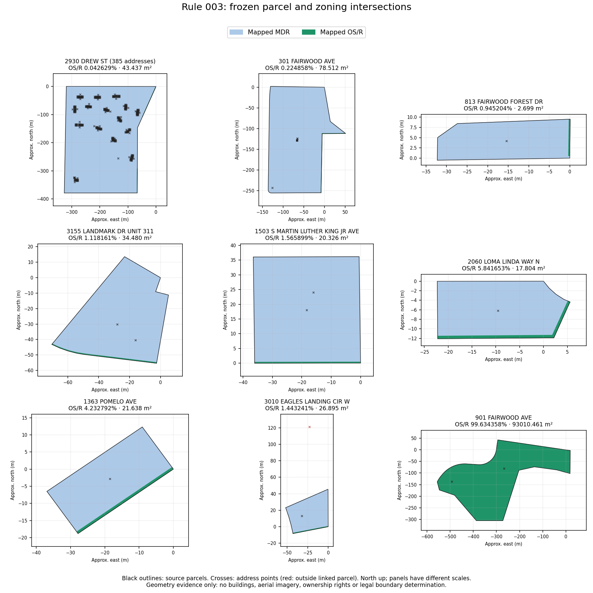

# Clearwater Rule 003 decision memo — MDR + OS/R

**October 16, 2026. Investigation only; no Rule 003 approval or classification implemented.** Basis: merged main `55904c848edca53132153ff639e587dcc5ec14ee` (PR #98), with PR #97 already incorporated. Research branch: `codex/clearwater-rule003-investigation`.

**Recommendation:** consider a bounded **731-address / 146-parcel-ID** MDR starting-guidance scope, after owner acceptance of the regulatory interpretation below. Retain every OS/R intersection and recommend its contextual notice on relevant physical-project Guides for **every positive OS/R intersection**, initially. Do not inherit Rule 002's 3% suppression policy. Hold two additional technically screened addresses on one parcel for a newly identified address-link discrepancy. The broader technical opportunity is 733; it is not the proposed approval count. No record is approved by this investigation.

## Reconciliation

The historical **736 / 733 / 3** counts reproduce exactly. Rule 002's merge did not change them. However, 736 describes the **exact mapped district pair**, not 736 existing-MDR classifications: 733 already have MDR primary codes; three already have OS/R primary codes.

| Mutually exclusive disposition | Remaining REVIEW addresses | Parcel IDs |
|---|---:|---:|
| Exact MDR + OS/R, existing MDR, passes existing source/human screen, no new address-link hold | **731** | **146** |
| Exact pair, existing MDR, passes existing screen, held for address-link investigation | 2 | 1 |
| Exact pair, existing OS/R, unsupported-primary source issue | 3 | 2 |
| MDR + OS/R plus one or more additional districts, outside proposed scope | 148 | 133 |
| **All remaining REVIEW profiles with both mapped districts** | **884** | **282** |

Thus the historical exact pair is 736 addresses / 149 parcel IDs; its existing diagnostic quality screen passes 733 / 147, failing three / two. The failing three are **not invalid parcel geometries**: all have `unsupported_zoning_code` alongside `parcel_ambiguous_zoning`, and OS/R covers 98.916917–99.634358%. Reassigning those to MDR would be particularly misleading. The wider 148-address group includes 73 existing-MDR addresses, but all additional-district combinations are excluded regardless of their existing primary code or apparent dominance.

The verified city baseline remains **63,430 original profiles**: 43,092 original CLEAN and 20,338 original REVIEW. Approved guidance remains **1,967 Rule 001 + 262 Rule 002 = 2,229**, disjoint, leaving **18,109** REVIEW without approved guidance. Conditional approval of the recommended 731 would yield **2,960** total approved guidance records and **17,378** remaining REVIEW. Actual new approvals in this investigation: **zero**. Resolving the held parcel could later add two, under separate authorization.

## Source verification and completeness

Reused the locally preserved **September 28 Release asset**, not an Actions artifact or live GIS replacement. Its SHA256 is `174c46ea4fca085a3ec81d443e003fa9abc0747741188bfbcc264b717af8a902`. The existing `verifySource` utility verified every pinned file's bytes/hash, source metadata and canonical layer hashes, Clearwater address membership, profile/source references and counts: **63,430 addresses, 112,466 raw parcel features, 761 zoning features, 47,716 address-linked parcel IDs**. Raw parcel features include land outside the address-defined city denominator.

Verified all cached approved-output checksums, the current merged approval configuration and pinned implementation/evidence hashes. Compared every serialized lookup original with its frozen source profile; no original field, zoning code or QA status differs. Checked the approved audit, both rule counts and the complete remaining-population ranking. The approved lookup SHA256 is `8cd40825ecb8f7a5d49e4b3d421dfbd9178a2e8046e26f54039e8c8171094a0b`. This is verified local output from the merged implementation, not a newly published Rule 003 workflow artifact. The successful merged Rule 002 workflow is [run 38972526303](https://github.com/zachlepore/groundrule/actions/runs/38972526303).

To avoid assuming the ambiguity diagnostic was exhaustive, screened **all 11,715 remaining REVIEW parcel IDs** against both MDR and OS/R source bounding boxes. **1,465** parcel boxes hit both; **five** lacked frozen diagnostics and were measured with the existing Rule 002 intersection utility. **Zero** of those five had both positive-area districts. The recomputed complete positive-pair population therefore remains 884 addresses. Bounding-box hits alone are not intersections.

Independently remeasured **all 149 exact-pair parcel IDs**, using the existing Turf algorithm and >0.000001 m² intersection floor. Every district percentage reproduced exactly; maximum area difference was **0.000495 m²**, explained by the frozen diagnostic's three-decimal versus supplemental six-decimal area rounding. No repeated same-code zoning polygons, overlapping same-code polygons, duplicate parcel identities, invalid parcel geometry or multipart parcels occur in this exact-pair cohort. All parcel geometries pass the existing Turf validity check; this is not a cadastral topology certification.

An additional cross-code intersection check found **0.084810 m²** of MDR/OS/R overlap on excluded Fairwood parcel `082916000004200100`. Its summed coverage is 100.000091%, inside the diagnostic tolerance; this illustrates why total coverage alone does not establish clean topology. No positive cross-code overlap was found on the 147 screened existing-MDR parcel IDs. Original diagnostics and flags remain intact; new observations are separate investigation evidence.

## OS/R distribution

Ranges are lower-exclusive / upper-inclusive. Parcel counts mean distinct source **IDs**, not independent land footprints. The initial 733 technical cohort includes the later two-address hold.

| OS/R coverage | All exact-pair addresses / parcel IDs | Technical existing-MDR addresses / parcel IDs |
|---|---:|---:|
| >0–0.1% | 495 / 9 | 495 / 9 |
| >0.1–1% | 194 / 100 | 194 / 100 |
| >1–2% | 32 / 27 | 32 / 27 |
| >2–3% | 0 / 0 | 0 / 0 |
| >3–5% | 5 / 5 | 5 / 5 |
| >5–10% | 7 / 6 | 7 / 6 |
| >10–20% | 0 / 0 | 0 / 0 |
| >20–50% | 0 / 0 | 0 / 0 |
| >50–100.1% | 3 / 2 | 0 / 0 |
| **Total** | **736 / 149** | **733 / 147** |

The proposed 731-address scope removes two addresses / one ID from the >1–2% band, making that band **30 / 26**. Technical existing-MDR OS/R coverage ranges **0.005949–5.841653%**. Parcel-ID-weighted median is **0.385954%**, 90th percentile **1.552239%**, 95th **4.682181%**. Address-weighted median is **0.042629%**, 90th **0.385954%**, 95th **1.118161%** (nearest lower order statistic, recorded in the JSON). These are strongly affected by shared land/address concentrations.

Three parcel IDs account for **582 / 733** technical addresses: 2930 Drew St (385), 2690 Enterprise Rd E (103), and 301 Fairwood Ave (94). This is 79.4% of the address opportunity, not 582 independent spatial confirmations.

## Spatial evidence and representative properties

These are **unreviewed analytical examples**, not new human QC observations or previously reviewed gold cases. No exact-pair parcel, or additional-district parcel in this population, matches the committed human-review records. Absence of a known exception does not establish absence of a real split.

| Property / parcel ID | OS/R % | MDR / OS/R area (m²) | Interpretation and disposition |
|---|---:|---:|---|
| 2930 Drew St, including Apt 1417 — `082916000004300100` | 0.042629 | 101,851.741 / 43.437 | 385 address records. Small percentage but nonzero mapped area on a large parcel; retain for physical-project review. Proposed scope. |
| 2690 Enterprise Rd E — `322816000002100300` | 0.081739 | 41,552.729 / 33.993 | 103 address records; another large-denominator example. Proposed scope. |
| 301 Fairwood Ave — `082916224670000010` | 0.224858 | 34,837.748 / 78.512 | 94 address records; more OS/R area than any of the >3% small-lot examples despite a much smaller percentage. Proposed scope. |
| 813 Fairwood Forest Dr — `082916274420000540` | 0.945204 | 282.808 / 2.699 | Boundary-adjacent strip in the frozen plot, near a hypothetical 1% presentation threshold. No legal de minimis conclusion. Proposed scope. |
| 3155 Landmark Dr Unit 311 — `202816236920033110` | 1.118161 | 3,049.174 / 34.480 | Shared geometry across several unit parcel IDs; two address profiles on this ID. Curved edge strip in plot. Proposed scope, with no inference about ownership/control. |
| 1503 S Martin Luther King Jr Ave / 1101 Woodlawn St — `222915229320000014` | 1.565899 | 1,277.745 / 20.326 | Two addresses, narrow mapped edge. Ordinary mixed-district starting-guidance candidate, not exclusively MDR. |
| 1363 Pomelo Ave — `212915474660040140` | 4.232792 | 489.561 / 21.638 | Long mapped edge strip; no evidence establishes whether it is usable project space or a harmless alignment difference. Proposed scope subject to the regulatory interpretation. |
| 2060 Loma Linda Way N — `012915936280001310` | 5.841653 | 286.967 / 17.804 | Largest screened percentage. OS/R follows two plot edges. Retain as potentially substantive; no claim that it is negligible. Proposed scope subject to the regulatory interpretation. |
| 3010 / 3029 Eagles Landing Cir W — `202816236450030830` | 1.443241 | 1,836.606 / 26.895 | **Hold both addresses.** 3029's source point lies about 79 m outside the identifier-linked footprint; 3010 lies inside. Establish correct address/parcel evidence before including either profile from this ID. |
| 901 / 801 Fairwood Ave — `082916000004200100` | 99.634358 | 341.419 / 93,010.461 | Existing OS/R, unsupported-primary issue, and small cross-code overlap. Exclude; MDR starting guidance would misrepresent the mapped parcel. |
| 2050 N Hercules Ave — `012915000002100100` | 98.916917 | 163.315 / 14,915.422 | Existing OS/R and unsupported-primary issue. Exclude. |
| 1923 N Betty Ln — `032915499860000050` | 0.440350 | 5,327.847 / 24.426 | Also **P 125.081 m² / 2.254916%**, invalid zoning geometry and incomplete coverage. Exclude as additional-district/source-quality case; do not import Rule 001 treatment. |



Plots show clipped source geometry and address points, not current aerial imagery, buildings, use, ownership, shoreline conditions or a human viewer inspection. Several strips look narrow in these polygons; their legal applicability cannot be read from shape alone. Ten of the eleven >3% screened parcel IDs are in the Madrid/Santiago/San Sebastian/San Marino/Loma Linda/Los Lomas group; the other is Pomelo. Together these cover **12 addresses**, with OS/R **4.232792–5.841653%**. None exceeds 10%, unlike the approved Rule 002 17.517240% and 30.946006% substantive-secondary cases. Lower percentages do not prove equivalent regulatory circumstances.

**Shared geometry:** the 149 exact-pair parcel IDs have only **42 byte-identical geometry groups**. Fifteen groups have multiple IDs, covering **122 IDs / 126 addresses**. Identical geometry under distinct authoritative IDs is different from repeated zoning features or duplicate parcel identity. It may reflect unit/shared-land representation; tenure, easements and exclusive-use rights were not supplied. Do not sum these footprints as independent acreage or infer project rights from the unit address. The held Eagles Landing parcel shares geometry with `202816236450030840` (3006 Eagles Landing Cir W), whose own point is inside; that distinct ID is not automatically held solely because its geometry is shared.

All **733** technical-cohort representative points lie in MDR; **732** address points lie within the linked parcel's MDR portion, and one is outside it. The original preprocessor obtains primary zoning from a **parcel representative point**, not a legal whole-parcel assignment. Retaining the existing primary code therefore avoids a code change but does not establish MDR authority throughout the parcel.

## Exclusions and unresolved interpretation

For the exact pair, the two OS/R-primary parcels / three addresses fail the existing unrelated-source-profile-issue veto (`unsupported_zoning_code`). The cross-code overlap is an additional, overlapping reason affecting two of those addresses, **not two more exclusions**. The new address-link hold affects a separate two addresses. No other existing exact-pair quality or human veto was found. The diagnostic's old `dominant_coverage_below_99.9_percent` label is retained as evidence; it is not an exclusion for a starting-guidance policy, just as in Rule 002.

All **148 / 133** additional-district addresses/IDs stay outside scope, even if technically clean:

| Additional combination | Addresses | Parcel IDs |
|---|---:|---:|
| MDR + OS/R + P | 85 | 83 |
| LMDR + MDR + OS/R | 34 | 30 |
| MDR + MHDR + OS/R | 8 | 8 |
| I + MDR + OS/R | 7 | 5 |
| LDR + MDR + OS/R | 4 | 2 |
| I + LMDR + MDR + OS/R | 3 | 1 |
| LDR + LMDR + MDR + OS/R | 3 | 1 |
| LMDR + MDR + OS/R + P + US19 | 2 | 1 |
| C + MDR + OS/R | 1 | 1 |
| C + D + I + IRT + MDR + O + OS/R | 1 | 1 |

Additional-district parcel-level quality reasons overlap: 55 IDs have unrelated source-profile issues, five invalid zoning geometry, five coverage failures, three repeated same-code features, one invalid parcel geometry. Their complete addresses, intersections and flags are in the inventory; do not add these overlapping reason counts to the mutually exclusive 148-address exclusion.

The proposed policy would continue to veto known true splits **that prevent confident primary guidance**, staff-review uncertainty, conflicting human evidence, duplicate identities, invalid parcel/zoning geometry, intersection failures, repeated/overlapping same-code features, coverage failures, unsupported/missing/changed primary codes, unconfirmed jurisdiction, unrelated profile problems and every additional district. All genuine mapped MDR/OS/R intersections remain visible at every percentage. A spatial split is not erased merely because MDR can be a useful starting Guide.

## Regulatory comparison with Rule 002

The authority reviewed is the repository's [Clearwater Community Development Code text](../clearwater/clearwater-development-code.txt), headed **Supplement No. 55, July 2026**, through Ordinance 9857-25 (December 4, 2025). SHA256: `9745beac8988ab96c4b7bd67ce506d02d1bbd0a62ed0dc990e2abfa53d81b7a0`. Page supplements differ by section. A read-only request to the [official online code](https://library.municode.com/fl/clearwater/codes/community_development_code) returned proxy CONNECT **403**; no current-online or later-ordinance verification is claimed. The code text supports the concerns below but does not authorize this cleanup rule.

* **§§ 2-301 and 2-301.1** (text lines 5823 onward): MDR protects medium-density residential neighborhoods and allows attached, detached and other residential types. Potential depends on Countywide Future Land Use designation; its table spans **7.5–18 units/acre**, with differing FAR/ISR. **§ 2-304** includes attached dwellings, assisted living, residential infill and other flexible-development uses. LMDR's **§§ 2-201 / 2-201.1** emphasize low-to-medium-density neighborhoods and a different potential table. MDR guidance cannot reuse LMDR use, density or dimensional rules.
* **§§ 2-1401 / 2-1401.1 / 2-1402 / 2-1403** (lines 12917 onward): OS/R is a distinct district for passive/active open space and recreation. It has its own uses, development standards and Countywide consistency requirements; the Recreation/Open Space row lists no residential dwelling-unit allowance and FAR .25 / ISR .60. That is not a basis to apply MDR residential potential to the OS/R acreage or to declare every accessory project prohibited. Mixed-site/accessory treatment requires human interpretation.
* **§ 1-108(A)** (line 4530 onward): development must satisfy both district and Countywide land-use provisions; the more restrictive density controls. Do not calculate units, impervious area or floor area from the entire mixed parcel under MDR alone. FLUP geometry, allocation of development rights, site plans and legal ownership were not analyzed here.
* **§ 1-109(B)(1), (4), (5)** (lines 4538–4605): boundaries can follow identifiable features, shore/seawall lines or water centerlines; unclear boundaries are determined by the Community Development Coordinator using ordinances, FLUP boundaries and historical development patterns. Neither a tiny GIS percentage nor a point-derived primary resolves that legal interpretation.

Rule 002 provides a useful **architecture**, not transferable regulatory evidence: retain original zoning/QA, use a separate offline approval, preserve secondary OS/R and exceptions, and limit notices to relevant physical-project contexts. Its >3% presentation threshold was owner-authorized with specific LMDR human observations. There are **zero MDR/OS/R human confirmations** here, no proof of negligible functional effect, shared footprint complexity and sizeable absolute OS/R areas below 1%. Its threshold is therefore not automatically supportable for MDR.

Residents could be misled if MDR starting guidance is used to place a pool/fence/shed in an OS/R strip, to treat shared land as individually controlled, to compute residential density/ISR using OS/R acreage, or to resolve a disputed boundary from point location. Primary guidance must explicitly remain non-exclusive and cannot replace project-location or City confirmation. The maps do not establish that any specific proposed project is allowed.

## Recommended policy and notice choice — requires owner approval

1. Scope only the **731 original-REVIEW, existing-MDR addresses on 146 exact-pair IDs** that pass retained source/human exclusions and have no newly identified address-link hold. This is a starting-guidance recommendation, not approval of residential development throughout the parcel. No changed/new-code scope or original CLEAN profiles.
2. Preserve MDR and OS/R, percentages, original QA/flags, source features, snapshot hashes and mapped/viewer access. Preserve the 1,967 Rule 001 approvals and its separate >2% P notice policy, and all 262 Rule 002 approvals and their >3% OS/R policy, unchanged.
3. Initially recommend the contextual notice for **every positive mapped OS/R intersection** in relevant physical-project Guides: a presentation threshold of **>0%** after the existing numerical intersection floor. This threshold has no effect on zoning applicability or primary eligibility. Suggested wording stays consistent with Rule 002: “Part of this parcel is mapped Open Space/Recreation (OS/R). Check the mapped district at your project location and confirm applicable requirements with Clearwater before proceeding.” Do not label uninspected OS/R as negligible or all properties as substantively assessed.
4. Require separate human/City interpretation when the intended project affects the OS/R portion, the legal boundary is unclear, primary applicability is disputed, or ownership/shared-land rights matter. Hold both Eagles Landing profiles until source linkage is reconciled. This investigation does not alter Guides or implement a project-screening system.

| Strict presentation threshold | Notices / no prominent notice, initial 733 technical addresses | Notices / no prominent notice, recommended 731 scope |
|---|---:|---:|
| >0% (recommended initially) | 733 / 0 | **731 / 0** |
| >1% | 44 / 689 | 42 / 689 |
| >2% | 12 / 721 | 12 / 719 |
| >3% (Rule 002 comparison only) | 12 / 721 | 12 / 719 |
| >5% | 7 / 726 | 7 / 724 |

The >0% recommendation deliberately accepts more notices to avoid asserting unverified insignificance; it is a cautious presentation choice, not a discovered statutory threshold. **2% versus 3% makes no difference in this cohort** because no qualifying overlap falls between them. A 5% threshold would hide five additional potentially relevant address cases. Even 1% would suppress notices on the large Drew/Fairwood parcels. A future less prominent treatment would need explicit owner authorization and additional property/project-specific evidence; percentage alone does not justify it.

**Owner decisions before implementation:** authorize the exact **731-address bounded scope** and non-exclusive MDR interpretation; accept or revise the proposed all-positive-intersection notice policy; acknowledge the limits on density/development and shared land, with City/planning interpretation where needed. Keep the two-address hold, three OS/R-primary addresses and 148 additional-district addresses excluded. If the owner needs case evidence before that interpretation, the highest-information examples are the 385-address Drew parcel, maximum-overlap Loma Linda, and shared-geometry Landmark; they are suggestions, not completed human reviews or an automatic new QC cycle. No Rule 003 approval configuration or approved exporter should be created until those decisions are explicit.

## Reproduction, outputs and validation

The read-only utility reuses the existing source verifier, intersection measurement, remaining-population ranking, review normalization and Rule 002 evidence loader. It emits investigation inventories and metrics only; it does not generate or modify an address-classification lookup.

```bash
node --max-old-space-size=4096 scripts/gis/investigate-clearwater-rule003.mjs \
  "$FROZEN_SOURCE" "$APPROVED_RULES_001_002" "$FRESH_INVESTIGATION_OUTPUT" "$RELEASE_ZIP"
node --test tests/clearwater-rule00*.test.mjs tests/clearwater-gis-pilot.test.mjs tests/clearwater-gis-full.test.mjs
```

Use source extracted/verified with `unpack-rule001-release.py` and the established Rule 002 approved export chain if a verified approved output is not already available. Do not substitute a prior Rule 003 classification. The invocation requires a fresh output directory and the pinned Release archive. **67 tests passed**, including three focused investigation-screen tests covering invalid/repeated/overlapping evidence and human/unsupported-source vetoes. Full investigation assertions passed, including all 63,430 original comparisons, source/config/output hashes and repeat geometry measurement. No new hosted workflow was added or dispatched for Rule 003.

Small review outputs: [reconciliation JSON](rule003-results/summary.json) and the nine-panel figure above. Complete generated parcel inventory (282 IDs), exact-pair clipped geometries, five supplemental measurements, evidence checksums and PDF are kept outside Git in `/workspace/clearwater-rule003/final-investigation/`; the downloadable evidence bundle includes those plus this memo, the small summary, plotting helper and tests. It contains no new approved lookup. No large generated GIS data is committed. Existing rules, workflows, approvals, Supabase, production Guides and resident UX are untouched. No deployment, PR or merge was performed.
